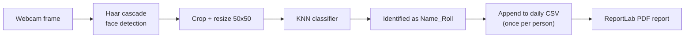
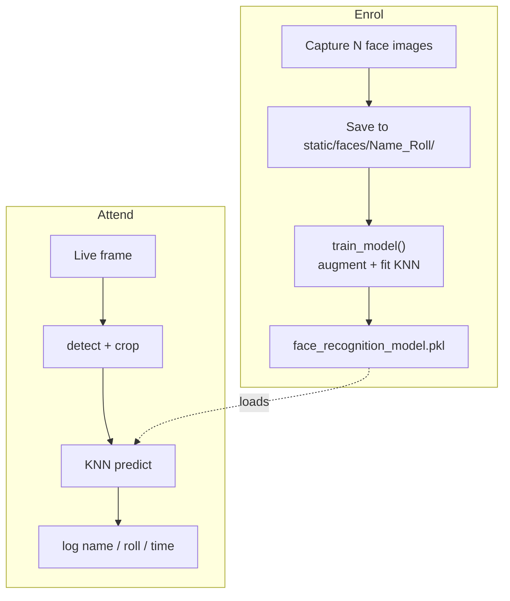

# Face-Recognition Attendance System

Mark attendance by **looking at a webcam** instead of signing a sheet. The app
detects a face, recognises who it is, and logs the name, roll number, and
timestamp — then exports the day's attendance as both a CSV and a PDF report.

<p>
  
  
  
  
  
  
</p>

---

## Why it matters

Manual roll calls are slow, easy to fake (proxy attendance), and painful to
tally. This system makes attendance **contactless and automatic**: register
once, then every future check-in is a glance at the camera, with a clean daily
report ready to download.

## Features

- **Webcam enrolment** — capture a set of face images per person, labelled by
  `Name_Roll`, straight from the browser-driven Flask app.
- **On-device recognition** — Haar-cascade face detection (OpenCV) feeds a
  **K-Nearest-Neighbours** classifier trained on the registered faces.
- **Data augmentation** — training randomly flips, rotates, and scales the face
  crops so the model generalises from only a handful of captures.
- **Automatic logging** — each recognised person is written once per day to a
  dated CSV with name, roll, and time.
- **PDF reports** — the day's attendance is rendered to a printable PDF via
  ReportLab.

## How it works



### Two phases: enrol, then recognise



## Tech stack

| Concern | Tool |
| ------- | ---- |
| Web UI | Flask + Jinja templates |
| Face detection | OpenCV Haar cascade (`haarcascade_frontalface_default.xml`) |
| Recognition | scikit-learn `KNeighborsClassifier` (k = 5) |
| Data wrangling | NumPy + pandas |
| Model persistence | joblib (`.pkl`) |
| Reporting | ReportLab (PDF) |

## Quickstart

```bash
python -m venv env && source env/bin/activate   # Windows: env\Scripts\activate
pip install -r requirements.txt

python app.py
```

Then, from the web UI:

1. **Register** a person — this captures their face images and retrains the model.
2. **Take Attendance** — the webcam recognises registered people and logs them.
3. Grab the day's report from `Attendance/Attendance-<date>.csv` / `.pdf`.

> The model and captured faces live under `static/`, and daily logs under
> `Attendance/`. Both folders are created automatically on first run.

## Project structure

```
app.py                                  Flask app: detection, KNN training, logging, PDF export
haarcascade_frontalface_default.xml     OpenCV face-detection cascade
templates/                              Flask HTML templates
static/
├── faces/<Name_Roll>/                  captured face images per person
└── face_recognition_model.pkl          trained KNN model
Attendance/
└── Attendance-<date>.csv / .pdf        generated daily reports
```

## Screenshots


